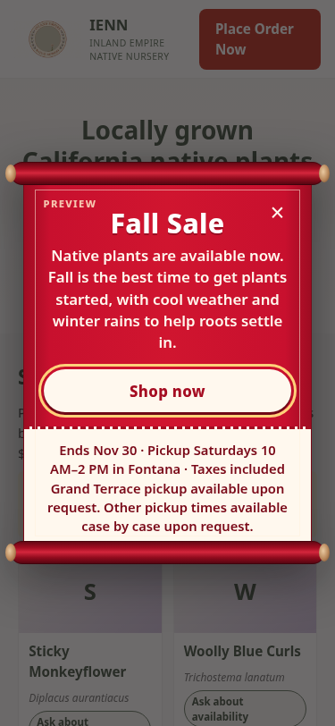
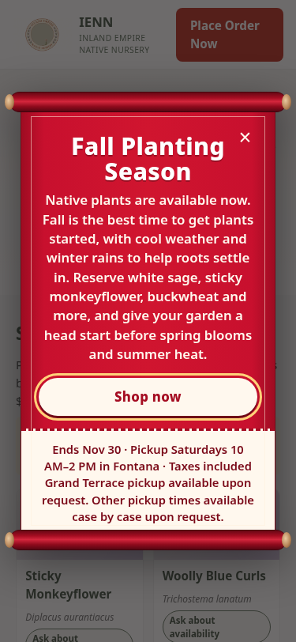
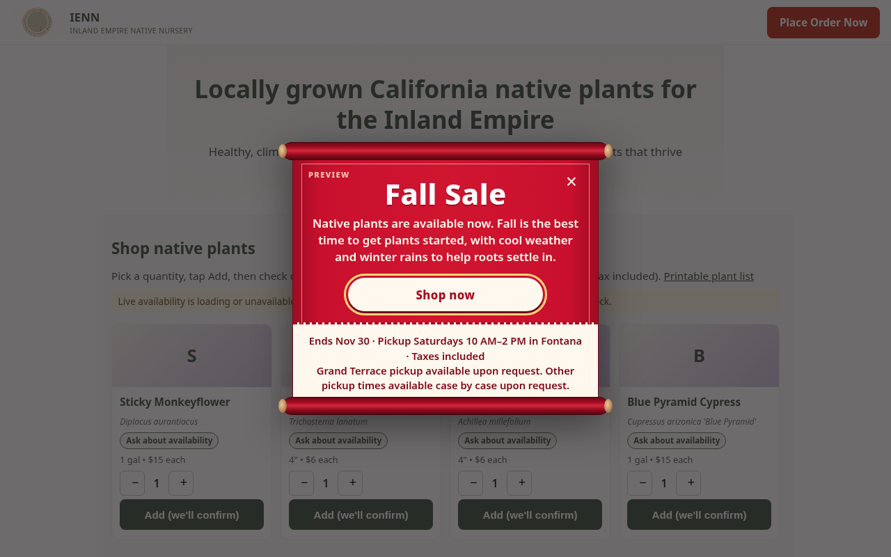

# Promo banner: scroll style options

Both versions are CSS only and pull their text from the active Promos row. To preview on any page, add `?promo=preview` to its link. The long-text shots use a made-up sample promo.

| | Current (on main) | Alternative (ribbon with notched tails) |
|---|---|---|
| 375px |  |  |
| 375px, long text |  |  |
| 1280px |  |  |

The alternative's code is on branch `kobe/promo-scroll-alt`. It is not merged.

## With bottom info

There is a cream footer strip at the bottom of the scroll, modeled on the footer strip from Lobo's #7 that Eric liked. It shows the end date and the pickup fine print (no discounts: team preference).

| 375px (blank Bottom info → default) | 375px, long text (seasonal text, custom Bottom info) | 1280px |
|---|---|---|
|  |  |  |

**To edit it in the sheet:** use the **Bottom info** column in the Promos tab. Its header can also be named Footer, Info, Details or Fine print. Type whatever you want the footer to say. Alt+Enter (Mac: Ctrl+Option+Enter) starts a new line inside the cell.

If you leave it blank, the strip shows "Ends <end date> · Pickup Saturdays 10 AM–2 PM in Fontana · Taxes included" plus the Grand Terrace / other-times fine print. The optional Highlight is shown only if filled in. When Bottom info is filled in, it replaces the default text, so include the end date in it. See [PROMOS.md](../../../PROMOS.md).
